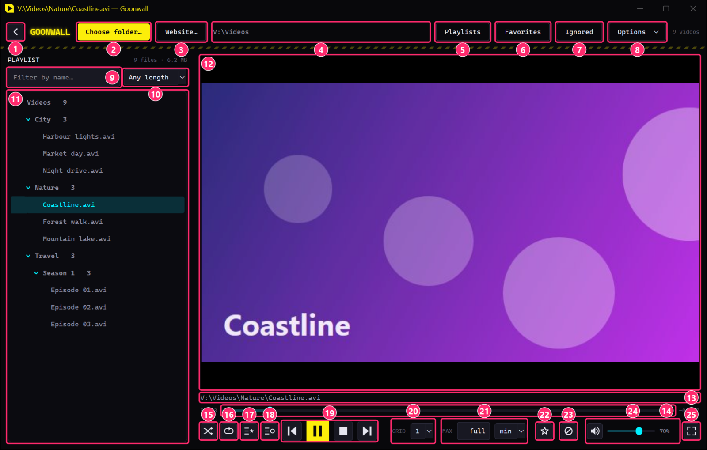
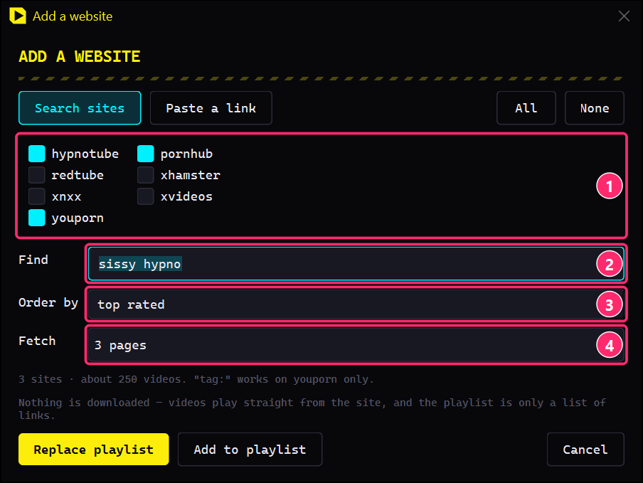
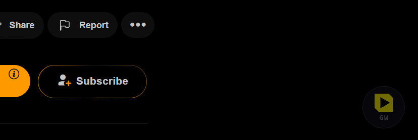
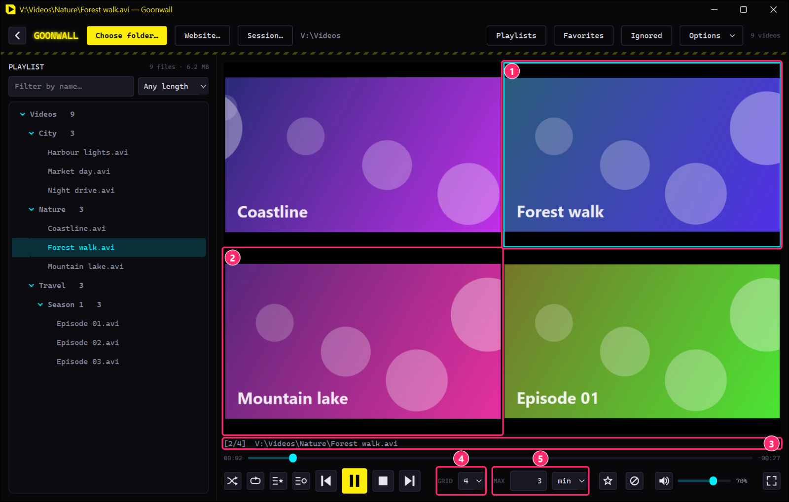
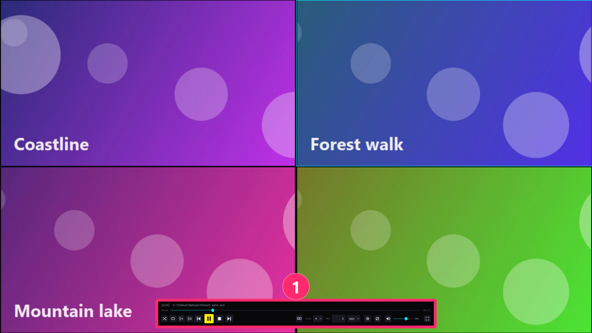
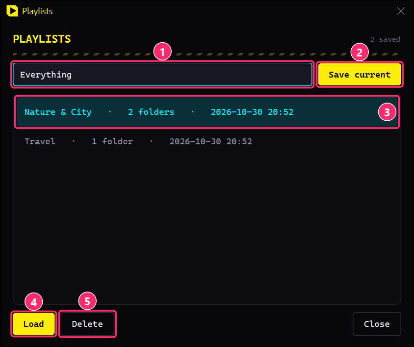
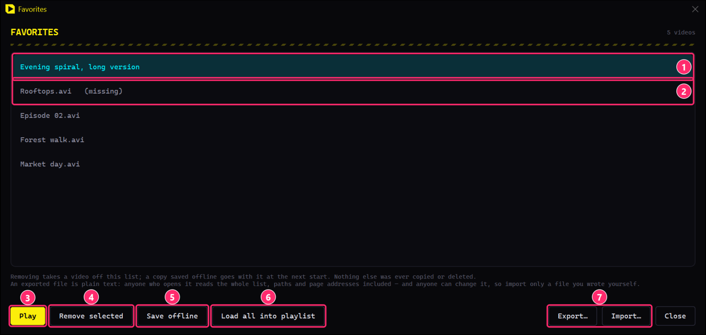

# Goonwall

A video player for Windows. Point it at a folder and every video in it — and
in every subfolder — becomes one playlist. You can play up to nine at once in
a grid, cap how long each one plays, shuffle without repeats, and save
playlists that pick up where they stopped.

The decoders come with it, so there's nothing else to install and no codec
pack to hunt down.

> ⚠️ **18+ only.** Goonwall plays whatever is in your folders, but the
> websites it can search and play from are adult sites.

---

## What's in the download

Goonwall comes in three pieces. Only the first one is required.

| | What it is | Do you need it? |
|---|---|---|
| **`Goonwall.exe`** | The player itself — folders, websites, the grid, everything this page describes. | **Yes.** On its own it does everything except the browser button. |
| **`GoonwallHost.exe`** | A small helper that your browser starts when you click **Add to Goonwall**. It drops the page's address where Goonwall picks it up — which is why that works even while Goonwall is closed. You never start it yourself and it has no window. | Only for the browser plugin. Keep it **in the same folder as `Goonwall.exe`**, that's where Goonwall looks for it. |
| **The browser plugin** (`Goonwall-extension.zip`, or the `extension` folder) | A Chrome/Edge extension that puts a **GW** button on the seven searchable sites and **Add to Goonwall** in the right-click menu everywhere, so you can send a page over instead of copying its address. See [From the browser](#from-the-browser). | Optional. It doesn't install itself — see [How to install the plugin](#how-to-install-the-plugin). |

So: just want to play your folders or search a site? `Goonwall.exe` is
enough. Want to hand pages over from the browser? Put all three in one folder
and follow [How to install the plugin](#how-to-install-the-plugin).

---

## First start

Double-click `Goonwall.exe`.

The first time, Windows will warn you about it. That's because the file isn't
code-signed, not because anything is wrong with it: click **More info → Run
anyway**. The single-file version unpacks itself on every start, so give it a
few seconds to show up. After that it runs at full speed.

Then hit **Choose folder…** and pick where your videos are. Next time you
start, that folder is already open.

Want a different folder right away? Drag it onto `Goonwall.exe`.

---

## The main window

| # | Control | What it does |
|---|---|---|
| 1 | **Playlist toggle** | Hides the playlist panel so the video gets the whole window, and brings it back (`Ctrl+L`). |
| 2 | **Choose folder…** | Replaces the playlist with one folder and everything under it (`Ctrl+O`). To *add* folders or single files instead, drag them onto the window. |
| 3 | **Website…** | Plays a site's search instead of a folder, or a link you paste (`Ctrl+W`). See [Websites](#websites). |
| 4 | **Sources** | What's loaded: a folder path, a search, a link, or just a count if there are several. Loaded a saved playlist? Its name comes first. Hover for the full list. |
| 5 | **Playlists** | Save what's loaded under a name, or load one back (`Ctrl+P`). See [Saved playlists](#saved-playlists). |
| 6 | **Favorites** | The videos you kept — play one again, or load the whole list (`Ctrl+B`). The number is how many. See [Favorites](#favorites). |
| 7 | **Ignored** | The videos you told it to skip, and the way to get them back (`Ctrl+I`). The number is how many. |
| 8 | **Options** | The settings you make once and then forget. See [Options](#options). |
| 9 | **Filter** | Narrows the playlist by name. Whatever it hides is also out of next, previous and shuffle. |
| 10 | **Length** | Plays only videos of a length: under 5 minutes, 5–20, or over 10, 20 or 40. Hover a row to see its length. See [Length](#length). |
| 11 | **Playlist** | What's loaded, as a tree with a count on each heading. Click or double-click a video to play it. Click a heading to fold it — that only tidies the view, nothing gets skipped. A star marks the ones you kept, and a right-click on any row keeps it or lets it go. The right-click also has **Remove from playlist** — on a heading it takes the whole folder (`Del` does the same for the highlighted row). That only tidies what's loaded now: nothing is remembered, and the next scan brings them back. To keep one out for good, ignore it. `Ctrl+Z` undoes the last removal. |
| 12 | **Video** | Double-click for fullscreen. |
| 13 | **Now playing** | The full path of what's playing, or its title if it isn't a file. While the speed isn't normal, it says so first, like `1.5×`. |
| 14 | **Seek bar** | Click or drag to jump. Elapsed on the left, remaining on the right. An A-B loop shows as an amber stretch on it — see [Looping a stretch](#looping-a-stretch). |
| 15 | **Shuffle** | Random order, no repeats. Videos you haven't seen come first, then the ones you saw longest ago (`S`). |
| 16 | **Endless** | After the last video, start over from the top — or with a fresh shuffle round (`R`). Off by default, so playback just stops at the end. With a website loaded, it first asks the site for more — see [Websites](#websites). |
| 17 | **Favorites only** | Plays only the videos you kept out of whatever is loaded. The rest stay in the list and come back when you switch it off. See [Favorites](#favorites). |
| 18 | **Unseen only** | Plays only the videos that have never played before (`U`). See [Unseen only](#unseen-only). |
| 19 | **Previous · Play/Pause · Stop · Next** | `P`, `Space`, –, `N`. With several videos on screen, Play/Pause and Stop hit all of them. |
| 20 | **GRID** | How many play at once, 1 to 9 (keys `1`–`9`). See [Several videos at once](#several-videos-at-once). |
| 21 | **MAX** | Cap per video, in seconds or minutes. `full` plays each one to the end. See [Max play time](#max-play-time). |
| 22 | **Favorite** | Keeps this video (`B`). The star is filled while what's on screen is one of them. See [Favorites](#favorites). |
| 23 | **Ignore** | Takes this video out of the playlist and keeps it out of future scans (`X`). Nothing is deleted from disk. `Ctrl+Z` undoes the last one. |
| 24 | **Mute · Volume** | `M` mutes. Moving the slider up from 0 unmutes. |
| 25 | **Fullscreen** | `F` or `F11`. `Esc` gets you out. |

### While you wait

Three things take a moment, and none of them can say how long. So each one
tells you it's working:

- A **small turning ring** next to the video count whenever something is
  happening in the background — a folder being searched, or a video being
  looked up.
- The line beside it says which: **Scanning…** plus the folder it's in,
  **Loading 3 videos…** while tiles are filling, **Fetching more from…**
  while endless asks a site for its next page, or **Saving offline:** and
  how far a download has got.
- The line above the seek bar says **Opening…** while the video is being
  looked up, and **Buffering…** while it's still arriving. Both matter mostly
  with websites, where you wait a second or two instead of nothing at all.

---

## Websites

A playlist doesn't have to come off your disk. Hit **Website…** (`Ctrl+W`)
and Goonwall plays a site's listing the same way it plays a folder.

There are two ways in, and the two buttons at the top pick between them:
**Search sites** asks the sites Goonwall can search by itself, **Paste a
link** plays an address you bring from anywhere else. Seven sites have a
search of their own, and the dialog fills itself from what they offer:

| Site | Besides a search | Order by |
|---|---|---|
| **hypnotube** | `channel:<name>` | newest, popular, top rated, longest, discussed |
| **pornhub** | `channel:<name>` | newest, popular, top rated, longest, hottest |
| **youporn** | `tag:<name>`, `channel:<name>` | newest, popular, top rated, longest, favourited |
| **redtube** | `channel:<name>` | newest, popular, longest, favourited |
| **xhamster** | `category:<name>`, `channel:<name>` | newest, best, best this week, best this month |
| **xvideos** | `tag:<name>` | newest, best this month |
| **xnxx** | — a tag name is just a search | newest, popular, best this month |

### A site with a search

| # | Control | What it does |
|---|---|---|
| 1 | **The sites** | Tick one, several, or all of them with **All**. The same search then goes to every ticked site, and each site gets its own heading in the playlist. |
| 2 | **Find** | What to look for. Leave it empty to browse the whole site, or use one of the prefixes from the table above to browse a channel, a tag or a category instead. A prefix only works on the sites that have it, and with several ticked the hint says which those are. |
| 3 | **Order by** | Whatever the ticked sites offer between them, as listed above. A site that doesn't have the one you picked uses **newest**, and the hint says which sites those are. The ordering also doesn't always reach a search: on youporn, xhamster, xvideos and xnxx it applies to browsing and to a tag, category or channel, while a search comes back in the site's own order. On redtube only newest and longest reach a search. |
| 4 | **Fetch** | How many listing pages to read **per site** — twenty to fifty videos each, depending on the site. The hint adds it up, which is worth a glance before you fetch five pages of all seven. |

The line under the form is the hint. With one site ticked it's that site's
own, saying what its Find box takes and which words it turns down. With
several it says how much you're about to fetch and what won't be the same
everywhere.

### A link

Hit **Paste a link** and paste an address. That reaches hundreds of sites —
but only by link. There's no search, so find the page on the site yourself
and bring the address over.

| | |
|---|---|
| **A video page** | Loads that one video. |
| **A channel, user or playlist page** | Loads every video on it, under the channel's own name in the playlist — up to 400, so a channel with thousands isn't hundreds of requests before anything plays. |

You can also **drag a link straight onto the window**, out of the address bar
or off a page, which adds it without opening the dialog at all. A folder and
a link in the same drag works too.

Both ways end with the same two buttons:

| | |
|---|---|
| **Replace playlist** | Load this instead of what's loaded now. |
| **Add to playlist** | Keep what's loaded and add this to it, so a site, a link and your own folders can play side by side. |

Everything else works like it does with files: shuffle, the grid, max play
time, next and previous, and **Ignore** to never see one again.

What's different:

- **Nothing gets downloaded** unless you ask for one favorite at a time to
  be saved offline (see [Favorites](#favorites)). The videos stream from the
  site, so starting one takes a second or so instead of being instant, and
  they use your connection for as long as they play.
- **Endless keeps going.** With endless on, Goonwall asks the site for the
  next page of the same search shortly before the playlist runs out, rather
  than starting over — up to 50 more pages per site and evening. Only when a
  site has nothing more to give does it start from the top. The saved
  playlist keeps the page count it was saved with. **Endless asks sites for
  more** under Options turns this off.
- **The list is read fresh every time.** Load the same search tomorrow and
  you get what the site shows tomorrow. A video that's been taken down is
  just gone, not a dead row.
- **The library line counts videos, not bytes.** There are no files to add up.
- A video that won't open is reported and skipped. If several fail in a row —
  the site is down, or your connection is — Goonwall stops trying and leaves
  the tile black instead of working through the whole list.
- **Goonwall tries the versions a site offers until one actually arrives.**
  Sites do advertise versions they then refuse to hand over, so the best one
  isn't always the one that plays. It takes the best one that does, which
  costs a moment before the first frame.
- **Some sites still won't play**, and a link being accepted is no promise.
  One that offers picture and sound only as two separate streams can't be
  played here at all: Goonwall plays one stream at a time, and says so rather
  than going black. Sites also refuse outright, or only answer from certain
  countries.

### From the browser

Instead of copying addresses over, you can hand a page to Goonwall straight
from the browser. It goes into the playlist the next time Goonwall looks —
**and that works while it's closed too**: start it later and the pages you
marked are already there.

| | |
|---|---|
| **The button** | On the seven sites Goonwall can search, a round **GW** button sits in the bottom right corner of the page. One click adds the page you're on. It stays faint until you point at it, and it gets out of the way while a video is fullscreen. |
| **The right-click** | **Add to Goonwall** is in the context menu on *every* site — on a page, a video or a link. On a link it adds what the link points at. This is your way into the hundreds of sites that have no button. |

It keeps to its corner, clear of the page's own controls.

This needs the browser plugin and `GoonwallHost.exe` (see [What's in the
download](#whats-in-the-download)), and you install the plugin by hand — it
doesn't come from the Chrome Web Store. Takes a minute, once: see [How to
install the plugin](#how-to-install-the-plugin).

---

## Several videos at once

| # | | |
|---|---|---|
| 1 | **Active video** | The one with the cyan frame. Click any video to make it the active one. Only it has sound, and the seek bar, title, next/previous and ignore all apply to it. |
| 2 | **Other videos** | Each one moves on to its own next video when it finishes. The same video never plays in two places at once. |
| 3 | **Now playing** | `[2/4]` means the second of four is active. |
| 4 | **GRID** | 1–9 videos. Rows stay as square as they can, and a shorter last row is centred: 3 = 2 + 1, 5 = 3 + 2. Fewer videos than places and the rest stay black. |
| 5 | **MAX** | Applies to every video in the grid. |

Decoding several high-resolution videos at once is real work for your GPU and
CPU. If playback stutters, use a smaller grid.

Three things you can do with one video in the grid:

| | |
|---|---|
| **Hold it** (`H`) | The active video plays again when it ends, instead of moving on, while the others carry on through the list. A held video has a dashed amber frame. `H` again lets it go, and so does picking another video for it (`N`, `P`, `X` or a click in the playlist). |
| **Make it big** (`Z`, or a middle click on it) | That video alone fills the grid. The others keep playing out of sight, silently, so they're where they'd be anyway when you come back. `Z` again, or a new grid size, brings them back. Double-click is still fullscreen, so the two combine. |
| **Let the sound move on** | Under **Options → Sound moves on**, the sound passes to the next video every 10, 20, 30 or 60 seconds. Clicking a video starts the count again. It rests while a video is big. |

---

## Fullscreen

Fullscreen opens on the monitor the window is on, and shows the whole grid.

| # | | |
|---|---|---|
| 1 | **Controls** | Show up when you move the mouse. After about 2.5 seconds of stillness they hide, and the pointer goes with them. They stay up while the pointer is over them, or while you're dragging. |

Moving the mouse on another monitor won't bring them back — only movement
over the video itself does.

Every keyboard shortcut works in fullscreen too.

---

## Saved playlists

| # | | |
|---|---|---|
| 1 | **Name** | What to save the current setup under. |
| 2 | **Save current** | Saves the loaded *folders and files*, not a fixed list of videos. Load it again and the folders get scanned again: new videos show up, deleted ones are gone, ignored ones stay hidden. Saving under a name that exists asks first. |
| 3 | **Saved playlist** | Shows the name, how many folders and files are in it, and when you saved it. Double-click to load. |
| 4 | **Load** | Replaces what's loaded. Folders that aren't there any more, say on an unplugged drive, are skipped with a note. |
| 5 | **Delete** | Deletes the saved playlist, nothing else. No video is touched. |

**It picks up where you stopped.** A saved playlist remembers the last video
that actually *played*. Load it again and playback carries on with the one
after that, so videos near the end of a long list get their turn too. After
the last one it starts over. Opening a playlist without playing anything
doesn't move it forward. With shuffle on the resume point is ignored, since
shuffle already puts unwatched videos first.

---

## Favorites

Press `B`, or the star left of the ignore button, to keep whatever is
playing. Press it again to let it go. The star is filled while what's on
screen is one of your favorites, and every video you kept has a star next to
it in the playlist. Right-click any row to keep that one instead, without
playing it first.

Nothing gets copied and nothing gets downloaded, unless you ask for it (see
*Saving one offline* below). What's written down is where the video was: a
file's path, or — for a video from a website — the *page* it was on, never
the stream behind it. That stream is signed and stops working within hours,
which is why a favorite from a site still plays months later, as long as the
page is still up.

**Favorites** in the header (`Ctrl+B`) opens the list, newest first. A file
shows its name, a video from a website its title; hover either one for where
it came from and when you kept it.

| # | | |
|---|---|---|
| 1 | **A video from a website** | Exactly the row this dialog is here for. There's no folder to open to get back to one of these, so this list is the only way. One that's saved offline says `(offline)`. |
| 2 | **A file that's gone** | Moved or deleted since you kept it, so it's marked `(missing)`. It stays on the list until you remove it — nothing gets dropped behind your back. |
| 3 | **Play** | Plays the selected video, or just double-click it. If it isn't in the playlist, the favorites get loaded first and it starts as soon as it's there. |
| 4 | **Remove selected** | Takes videos off the list. Your own files are never deleted; a copy saved offline goes with its favorite at the next start. |
| 5 | **Save offline** | Downloads the selected videos from their sites and keeps them on this PC. See below. |
| 6 | **Load all into playlist** | Adds every favorite to what's already loaded, just like dragging in a folder. They arrive under their own headings, by where they came from. |
| 7 | **Export… · Import…** | Export writes the whole list to a file you pick, Import reads one back in. Importing *adds* to what's there: videos you already kept stay as they are, with the date you first kept them, and the dialog says how many arrived and how many were already on the list. A file that isn't a Goonwall export is turned down with a reason, and nothing changes. |

That export is how you get your favorites onto another PC — everything else
Goonwall stores is encrypted with your Windows login and can't be read
anywhere else. The catch is that the exported file is **plain readable
text**: paths, titles and page addresses, open to anyone who finds it. Keep
it wherever you'd keep the list itself.

### Saving one offline

A favorite from a website lives on its page, and pages get taken down.
**Save offline** downloads the selected ones, one after another, while the
status line in the main window shows how far it has got. From then on the
video plays from your disk, even once the page is gone, and the row says
`(offline)`.

- **Where:** `%APPDATA%\Goonwall\offline`, or a folder you pick under
  **Options → Offline folder…**. The files are named by a code, not by their
  title.
- **They are not encrypted.** Everything else Goonwall keeps is; a video file
  can't usefully be. Anyone who finds the folder can play them.
- **The copy belongs to the favorite.** Remove the favorite, or ignore the
  video, and its copy is deleted the next time Goonwall starts — not at once,
  so `Ctrl+Z` still finds it. Nothing else in that folder is touched.
- **Not every site can be saved.** Some only send their videos in hundreds of
  small pieces, which can't be put back together into one file here; then
  Goonwall says so and keeps streaming it. As of this version hypnotube,
  pornhub and xvideos save; redtube, xhamster and youporn don't.
- Exports don't include the copies or where they are, and Goonwall stops a
  download in progress when you quit.

### Favorites only

**Favorites only** (17 in the transport bar) is the other way round. It
leaves the playlist alone and plays only the videos in it you kept. A folder
of 800 files with 30 favorites in it stays that folder, and switching the
mode off brings the other 770 back. The playlist shows exactly what will
play, so rows that aren't favorites are hidden while it's on — and if none of
them is, the list is empty and Goonwall says so. Whatever is already playing
keeps playing; the mode only decides where the *next* video comes from. It's
remembered, so it's still on at the next start.

Ignoring a video you had kept (`X`) takes it off the favorites too and says
so. `Ctrl+Z` undoes both.

---

## Unseen only

**Unseen only** (18 in the transport bar, `U`) plays only the videos that have
never played before — the same history shuffle uses to put unwatched videos
first. "Played" means started: skipping one after two seconds counts.

What plays while it's on stays in the list, so the row doesn't vanish from
under the video showing it, but it never comes round again. With endless on,
playback stops once nothing unseen is left, instead of starting over. Turning
the mode off and on again takes a fresh look. Together with **Favorites only**
it plays the favorites you haven't seen yet. It's remembered.

The history holds the last 20,000 videos played.

---

## Length

**Length** (10 in the main window) beside the name filter plays only videos of
a length: under 5 minutes, 5–20, over 10, over 20 or over 40. Hover a row to
see how long it is. Like the name filter, whatever it hides is also out of
next, previous and shuffle; unlike the name filter, it stays set when you load
something else.

Goonwall knows a length from three places: a website's listing says it (all
the searchable sites but pornhub do), Windows knows it for most video files
and is asked in the background right after a folder is loaded, and any video
that has opened once is known from then on. What's learned is remembered.

A video whose length isn't known yet is **kept** by the filter, or a freshly
loaded folder could come up empty. Hover the filter to see how many those
are. **Options → Length filter hides unknown lengths** hides them instead.

---

## Speed

`+` and `-` step every video on screen through 0.5×, 0.75×, 1×, 1.25×, 1.5×
and 2×. While it isn't 1×, the line above the seek bar starts with the speed.
It goes back to 1× at the next start.

**MAX** counts the video's own minutes, not the clock's: three minutes at 2×
pass in a minute and a half.

---

## Looping a stretch

`L` on the active video sets the start of a loop, `L` again the end, and from
then on it jumps back to the start every time it gets there. A third `L` stops
it. The seek bar shows the stretch in amber. Jumping somewhere outside it
stops the loop too, and so does another video in that tile. While a loop runs,
**MAX** waits.

---

## Max play time

Set **MAX** (21 in the main window) to, say, `3 min`:

| Video length | What plays |
|---|---|
| 30 min | 3 minutes, starting somewhere between minute 20 and 22, e.g. 20:36–23:36 |
| 10 min | about 6:40–9:40 |
| 5 min | 2:00–5:00, the last 3 minutes, because 3 minutes no longer fit after the two-thirds mark |
| 2 min | the whole video |

Long videos start a little past the two-thirds mark, once the intro is over.
The start point is random, so the same video doesn't show you the same
minutes every time. When the time is up the next video starts, exactly as if
this one had ended. Seek by hand and the limit restarts from where you landed.

**Options → MAX starts** changes where the stretch begins: **just past
two-thirds** as above, **anywhere** in the video, or **from the start**, which
simply cuts each video off after the limit.

---

## Options

The **Options** button in the header holds what you set once and then leave:

| | |
|---|---|
| **Discreet window** | The window title says only "Goonwall", never the video's name — that title is also what the taskbar, Alt+Tab and screen-sharing pickers show. The taskbar preview and Alt+Tab show the app icon instead of the video. |
| **Panic key** | Which key hides everything: see [Panic key](#panic-key). |
| **MAX starts** | Where a long video's stretch begins, see [Max play time](#max-play-time). |
| **Sound moves on** | Hands the sound to the next video every so often, see [Several videos at once](#several-videos-at-once). |
| **Endless asks sites for more** | On by default. See [Websites](#websites). |
| **Length filter hides unknown lengths** | Off by default. See [Length](#length). |
| **Offline folder…** | Where favorites saved offline go. Copies already made stay where they are. |

All of them are remembered.

---

## Panic key

**Ctrl+Shift+Space** — from any program, Goonwall in front or not — pauses
everything, mutes, leaves fullscreen and hides the window and any dialog, and
the taskbar entry with them. Press it again and Goonwall comes back,
**still paused**: sound starting up because you hit the key by mistake is the
one thing it must not do. While it's hidden, a tray icon brings it back too.

Under **Options → Panic key** you can pick **Pause**, **Scroll Lock** or
**Ctrl+Alt+H** instead. If another program already uses the key, Goonwall
says so; the key then only works while Goonwall is the window in front. The
mute from a panic is never remembered, so the next start isn't silent.

---

## Keyboard

| Key | Action |
|---|---|
| `Space` | Play / pause (all videos) |
| `←` `→` | Back / forward 5 seconds (active video) |
| `N` / `P` | Next / previous video (media keys work too) |
| `M` | Mute |
| `S` | Shuffle on/off |
| `R` | Endless on/off |
| `U` | Unseen only on/off |
| `1` … `9` | How many videos on screen |
| `+` / `-` | Faster / slower (all videos) |
| `H` | Hold the active video: it plays again instead of moving on |
| `Z` | The active video alone, big; again for the grid |
| `L` | Loop: start, end, off |
| `B` | Keep the current video, or let it go |
| `X` | Ignore the current video |
| `Del` | Remove the highlighted row (or folder) from the playlist |
| `Ctrl+Z` | Undo the last ignore or removal |
| `F` / `F11` | Fullscreen; `Esc` leaves |
| `Ctrl+O` | Choose a folder |
| `Ctrl+W` | Add a website |
| `Ctrl+L` | Show/hide the playlist |
| `Ctrl+P` | Saved playlists |
| `Ctrl+B` | Favorites |
| `Ctrl+I` | Ignored videos |
| `Ctrl+Shift+Space` | Panic: hide everything, or bring it back paused — works from any program |

While you're typing in a text field — the filter, a playlist name, the MAX
box — the keys go into the field instead. `↑` and `↓` are never transport
keys: they walk the playlist when it has the focus, and step the number when
you're in the MAX box.

---

## How to install the plugin

The browser plugin is what gives you the **GW** button and **Add to Goonwall**
in the right-click menu — see [From the browser](#from-the-browser) for what
they do. It's optional, it doesn't come from the Chrome Web Store, and you
install it by hand. Takes a minute, once.

You need all three pieces from [What's in the
download](#whats-in-the-download): `Goonwall.exe`, `GoonwallHost.exe` and the
plugin.

1. **Put everything in one folder** where it can stay — `Goonwall.exe` and
   `GoonwallHost.exe` side by side. If you downloaded
   `Goonwall-extension.zip`, unzip it there too, so you have an `extension`
   folder next to the two exes. Chrome doesn't copy that folder, it reads it
   where it lies, so moving or deleting it later takes the plugin with it.
2. **Start Goonwall once.** That's what tells the browser where to find
   `GoonwallHost.exe`, the helper that carries the address over. Nothing to
   click, it happens on every start. Skip it and everything else looks right
   while nothing works. Moved the folder later? Start Goonwall once more.
3. **Open `chrome://extensions`.** Type or paste that into the address bar.
4. **Switch on *Developer mode*** with the toggle in the top right. Three
   buttons show up above the list.
5. **Click *Load unpacked*** and pick the `extension` folder from step 1 —
   the folder itself, not a file inside it.

A card called **Add to Goonwall** appears in the list. That's it, there's
nothing to configure.

Its **Site access** names the seven sites and nothing else. That's where the
button gets drawn, and it's the only reason the plugin needs to be allowed
anywhere at all — more on that below.

**Edge works exactly the same way**, at `edge://extensions`.

### Checking that it worked

Open one of the seven sites and click the round button in the bottom right —
or right-click any page at all and pick **Add to Goonwall**. Either way a
small note shows up in the top right corner for a moment:

| | |
|---|---|
| **ADDED TO GOONWALL**, green | The address arrived. Switch over and it's in the playlist; if Goonwall is closed, it'll be there at the next start. |
| A red line | It didn't, and the note says why — usually that Goonwall has never been started on this PC, which is step 2, or that `GoonwallHost.exe` isn't next to `Goonwall.exe`, which is step 1. |

The same mark shows on the plugin's icon, which is what you get on the
handful of pages no extension may write on: `chrome://` pages, the Web Store,
a PDF. There the note stays away and only the icon says anything, so it's
worth pinning — click the puzzle-piece button in the toolbar, then the pin
next to **Add to Goonwall**.

### Removing it

**Remove** on its card in `chrome://extensions`. Nothing stays behind in the
browser, and Goonwall keeps working as before.

### What it can and can't do

- **It's allowed on seven sites, and only because of the button.** Drawing
  something on a page means running there, and running there is a permission
  — so it names those seven and no others. On every other site on the web it
  can do nothing at all until you right-click, and what it may do then lasts
  for that one click, in that one tab.
- **It only ever sends an address**, the one the browser was already showing.
  It doesn't read the page, and the button doesn't even tell Goonwall which
  page it's on — that comes from the tab itself.
- **The note is the one thing it puts on a page**, for two seconds, in a
  closed container of its own so the page can't reach into it.
- **The link is looked up when it plays**, not when you click. So a page
  Goonwall can't play is only reported later, when it tries — same as a
  pasted link.
- **Developer mode has to stay on**, and Chrome will ask about it once per
  start. That's the price of an extension that doesn't come from the Web
  Store.

---

## What's remembered, and where

Goonwall keeps a little of its own data in `%APPDATA%\Goonwall` — paste that
into the Explorer address bar to find it:

- **The favorites** — the videos you kept, each with where it was and when
  you kept it.
- **The ignore list** — what you told it to skip.
- **The play history** — what shuffle and unseen only use.
- **Video lengths** learned along the way, for the length filter.
- **Saved playlists**, with their resume points.
- **Favorites saved offline**, in the `offline` folder unless you picked
  another one — the only video files Goonwall ever writes.
- **Pages marked in the browser** that haven't been picked up yet — see *From
  the browser*. They leave the moment they go into the playlist.
- **Your settings** — shuffle, endless, favorites only, unseen only, max play
  time, grid, volume, mute, everything under Options, the playlist panel and
  the window size — plus what was loaded, so the next start carries on where
  you left off.

What it stores about a website is the *question*: the site, the search and the
ordering, the same way a folder is stored as its path. Never the videos it
answered with, and never a list of what they were. The favorites are the one
exception, and they have to be — keeping one video means writing down which
video it was, and for a website that's the address of its page.

Delete that folder and everything resets. No video is ever touched by it.

---

## Privacy

All of that is a list of file paths, so it's stored **encrypted**, with
Windows DPAPI. The key is your Windows login: other accounts on the same PC,
and anyone who copies the files to another computer, get unreadable data.
The one exception is favorites you save offline: those are ordinary video
files — see [Saving one offline](#saving-one-offline).

For the moments you'd rather nobody saw what's on screen, there's the
[panic key](#panic-key), and **Options → Discreet window** keeps video names
and pictures out of the taskbar, Alt+Tab and screen-sharing pickers.

Flip side of the same sentence: these files don't travel. On another PC
Goonwall just starts fresh. The one way across is **Export…** in the
favorites dialog, and what that writes is deliberately *not* encrypted — see
[Favorites](#favorites).

Goonwall has no update check and no telemetry, and it never sends your data
anywhere. With only folders loaded it makes no network connections at all.

A website source — a search or a pasted link — is the exception, and only
while you're using it. Goonwall then talks to that site the way a browser
would: it fetches the listing or the page you pointed it at, and asks for a
video's address when that video is about to play.

Some sites hand out an address their server will only serve if it's told which
page the request came from, and the video player inside Goonwall has no way
to say so. For those, Goonwall passes the video through itself: it opens a
port on **127.0.0.1**, your own machine, reachable from nowhere else, and
fetches the video with the right thing said. The port opens the first time
it's needed and closes when you quit, and nothing can be asked through it
except the videos Goonwall is playing. Your IP address is visible to the
site, same as when you visit it yourself, and the videos stream from the site
rather than off your disk. Nothing is sent about you, your folders, or what
else is in your playlist, and nothing is downloaded or kept unless you save a
favorite offline.

To learn how long your video files are, Goonwall asks Windows — the same
number Explorer shows in its Length column. Nothing leaves your PC for that.

Windows itself may remember the last folders you opened in the folder
picker — that's the file dialog, not Goonwall.

---

## If something goes wrong

| | |
|---|---|
| **A video stays black or gets skipped** | Its format isn't one Windows and the built-in decoders handle. The file stays in the playlist; `X` gets rid of it for good. |
| **Playback stutters in a grid** | Fewer videos at once, or close other GPU-heavy programs. |
| **A folder is missing after a restart** | Its drive wasn't connected at start. Plug it in and open the folder again. |
| **"1 source did not answer"** | One of the folders or websites that were loaded together couldn't be read — the rest of the playlist is fine. Hover the video count in the top right to see which one it was and what it said. |
| **A website source finds nothing** | Try it with the search box empty. If that works, your search had no results; if it doesn't, the site is unreachable or has changed. |
| **A search finds nothing on one site but plenty on another** | Some sites turn words down outright instead of answering with what they have — "hypno" is one that every site here except hypnotube refuses. Browse a shelf, a tag, a category or a channel instead. |
| **A link isn't accepted** | Not every site is known, and a listing or search page usually isn't — use the page of a video, channel, user or playlist. |
| **"no stream here carries both picture and sound"** | That site offers them separately, and Goonwall plays one stream at a time. Nothing to be done from here. |
| **A linked video is listed but stays black** | Every version the site offers was refused. Try the page in a browser: if it won't play there either, there's nothing to be done from here. |
| **Website videos stop after a few tiles** | Several failed to open in a row, so Goonwall stopped trying. Load the source again once your connection is back. |
| **A website video is slow to start** | It streams from the site, so a second or two is normal. Many at once share your connection. |
| **"Add to Goonwall" says Goonwall didn't answer** | Chrome doesn't know where the helper is. Start Goonwall once — every start sorts it out — and try again. Same thing after moving the program somewhere else, since it registers itself by its own location. Also check that `GoonwallHost.exe` sits next to `Goonwall.exe` — see [How to install the plugin](#how-to-install-the-plugin). |
| **A page added from the browser isn't in the playlist** | It gets added when Goonwall next looks, which is at startup and whenever you switch back to its window. Click the window once. A page you added several times is only added once. |
| **The window opens off-screen** | It only restores onto a monitor that still exists, but if it's ever stuck, delete `%APPDATA%\Goonwall\settings.dat`. |
| **The panic key does nothing while another program is in front** | Another program holds that key, and Goonwall said so when it started. Pick a different one under **Options → Panic key**. |
| **Goonwall vanished** | The panic key hid it. Press it again, or click the Goonwall icon in the tray. |
| **The length filter shows videos of the wrong length** | It keeps videos whose length isn't known yet — hover it to see how many. **Options → Length filter hides unknown lengths** hides them. |
| **"…is only streamed in pieces (HLS)"** | That site's videos can't be saved offline. It still plays from the site. |
| **Everything should start over** | Delete `%APPDATA%\Goonwall`. |
